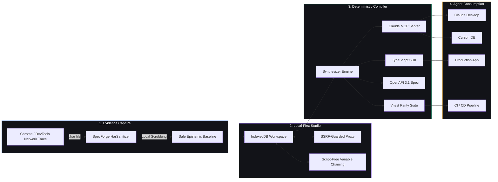

<div align="center">

# ⚡ SpecForge Studio

### The Local-First API Client, `.har` Network Trace Interceptor & Deterministic MCP/SDK Compiler.

**Turn recorded network traffic into production Claude MCP servers, TypeScript SDKs, and OpenAPI 3.1 specifications in 12 seconds.**

[](https://github.com/NeuralithDev/SpecForge)
[](#license)
[](#why-specforge)
[](#claude-desktop--cursor-integration)
[](#compiled-artifacts)
[](#compiled-artifacts)
[](#security--privacy-guarantee)

<br />

[Live Studio](#quick-start) · [Why SpecForge](#why-specforge) · [Core Features](#core-features) · [Architecture](#architectural-pipeline) · [Claude & Cursor Integration](#claude-desktop--cursor-integration) · [User Manual](USER_MANUAL.md)

<br />

```bash
# Clone and launch SpecForge Studio locally in 30 seconds
git clone https://github.com/NeuralithDev/SpecForge.git
cd SpecForge
npm install
npm run dev:web
```

</div>

---

## 🧭 Why SpecForge?

Traditional API clients were built for a previous decade. They force developers into cloud accounts, sync private environment variables to third-party databases, deprecate offline scratchpads, and introduce massive bloat.

Meanwhile, **AI coding agents (Claude, Cursor, Windsurf, Copilot)** need accurate API contracts to execute tool calls without hallucinating parameters, types, or endpoints.

**SpecForge bridges this gap with mathematical determinism.**

Instead of prompting an LLM to guess an undocumented API's parameters, you capture authentic HTTP traffic directly from Chrome, Firefox, or Safari, drop the `.har` file into SpecForge, and let our deterministic compiler synthesize:

1. **A Model Context Protocol (MCP) server** for Claude Desktop and Cursor.
2. **A zero-dependency TypeScript SDK** with strict Zod runtime validation.
3. **An OpenAPI 3.1 specification**.
4. **An executable Vitest contract parity test suite** anchored to real response payloads.

All of this runs **100% locally in your browser** with zero telemetry, zero mandatory sign-ins, and zero cloud lock-in.

---

## ⚡ Architectural Comparison

| Capability                     | SpecForge Studio                       | Legacy Cloud API Clients        | AI Prompt Generators            |
| :----------------------------- | :------------------------------------- | :------------------------------ | :------------------------------ |
| **Data Privacy & Sovereignty** | **100% Local-First (IndexedDB)**       | Forced Cloud Sync               | Prompts Sent to Remote LLMs     |
| **Offline Scratchpad**         | **Permanent Offline Capability**       | Deprecated / Gated behind login | Requires Internet & API Key     |
| **Network Trace Ingestion**    | **1-Click `.har` Ingest & Auto-Group** | Manual endpoint creation        | Inaccurate guesses              |
| **Credential Scrubbing**       | **In-Memory Auto-Scrubbing**           | Stored on Cloud Servers         | Tokens Leaked in Prompt History |
| **Claude & Cursor MCP**        | **Native `@modelcontextprotocol/sdk`** | Unsupported                     | Hallucinated parameters         |
| **TypeScript SDK Generation**  | **Automated 1-Click ZIP Bundle**       | Paid Add-on                     | Untested boilerplate            |
| **Vitest Contract Parity**     | **Cryptographically Anchored**         | None                            | Manual writing required         |
| **SSRF-Guarded Proxy**         | **RFC 1918 Private Subnet Blocked**    | None                            | N/A                             |
| **Pricing & Quota**            | **25 Endpoints Free Forever**          | Aggressive workspace limits     | Token cost per generation       |

---

## 🚀 Core Features

### 1. 🛡️ Zero-Leakage `.har` Network Interceptor

Drop raw `.har` network archives exported from Chrome DevTools or Proxyman without fear. SpecForge's client-side `HarSanitizer` automatically scrubs:

- Live Stripe, OpenAI, GitHub, and AWS API keys
- `Bearer`, `Basic`, and custom authorization headers
- Session cookies (`connect.sid`, `_session`, `jwt`, `token`)
- Query parameters containing credentials or tokens

The trace is parsed, categorized into collections by domain and route hierarchy, and instantly populated in your offline workspace.

### 2. 🤖 12-Second Claude & Cursor MCP Compiler

Transform any captured collection into a compliant Model Context Protocol (`@modelcontextprotocol/sdk`) server ready for Claude Desktop and Cursor:

- **Zod Schema Inference**: Infers parameter types, optionality, and descriptions from authentic requests and responses.
- **JSON-RPC 2.0 Stdio Transport**: Generates standard stdio tools that agents can invoke natively.
- **Deterministic Execution**: Zero hallucinations—tool definitions match the exact HTTP signatures recorded.

### 3. 📦 TypeScript SDK & Vitest Parity Generator

Download a fully configured, production-ready package with a single click:

- **Zero-Dependency Client**: Pure TypeScript `fetch` client with complete type safety.
- **OpenAPI 3.1 Spec**: Fully valid OpenAPI 3.1 document with schema definitions.
- **Vitest Parity Suite**: Executable tests that assert actual responses against the recorded cryptographic baseline.
- **Pre-configured Toolchain**: Includes `tsconfig.json` and `package.json` ready for `npm install` and `npm run test`.

### 4. 🔗 Script-Free Variable Chaining

Say goodbye to complex pre-request and post-response JavaScript scripts. SpecForge lets you click any field in a JSON response (e.g. `ch_3N9z...1x4q` or `token`) to map it to an environment variable (`{{LAST_CHARGE_ID}}`), automatically injecting it into downstream request URLs, headers, or payloads.

### 5. 🛡️ SSRF-Guarded Security Proxy

Test live endpoints without exposing your local network:

- Blocks private IPv4 ranges (`10.0.0.0/8`, `172.16.0.0/12`, `192.168.0.0/16`)
- Blocks loopback addresses (`127.0.0.0/8`, `::1`)
- Blocks cloud metadata endpoints (`169.254.169.254`)
- DNS rebinding validation and header normalization

### 6. 📊 Visual Schema Drift Radar

Compare real-time API responses against your recorded `.har` baseline. SpecForge highlights type mutations, missing properties, and unexpected additions with surgical accuracy before they break your production agents.

---

## 🏗️ Architectural Pipeline



---

## 📦 Compiled Artifacts Structure

When you export a compiled bundle from SpecForge Studio, you receive a self-contained ZIP containing:

```
specforge-mcp-sdk-bundle/
├── mcp-server.ts       # Claude Desktop & Cursor MCP Server (stdio transport)
├── client.ts           # Zero-dependency TypeScript API Client
├── openapi.json        # Strict OpenAPI 3.1 specification
├── contract.test.ts    # Vitest contract parity verification suite
├── package.json        # Pre-configured scripts (build, start, test)
└── tsconfig.json       # Strict TypeScript 5.7 configuration
```

### Generated MCP Server Example (`mcp-server.ts`)

```typescript
import { McpServer } from "@modelcontextprotocol/sdk/server/mcp.js";
import { StdioServerTransport } from "@modelcontextprotocol/sdk/server/stdio.js";
import { z } from "zod";

const server = new McpServer({
  name: "stripe-mcp-server",
  version: "1.0.0",
});

server.tool(
  "create_charge",
  "Create a new customer charge in Stripe Billing",
  {
    amount: z.number().describe("Amount in smallest currency unit"),
    currency: z.string().describe("Three-letter ISO currency code"),
  },
  async ({ amount, currency }) => {
    const res = await fetch("https://api.stripe.com/v1/charges", {
      method: "POST",
      headers: { "Content-Type": "application/x-www-form-urlencoded" },
      body: new URLSearchParams({ amount: String(amount), currency }),
    });
    const data = await res.json();
    return {
      content: [{ type: "text", text: JSON.stringify(data) }],
    };
  },
);

const transport = new StdioServerTransport();
await server.connect(transport);
```

---

## 🤖 Claude Desktop & Cursor Integration

To add your compiled SpecForge MCP Server to **Claude Desktop**, add the following snippet to your `claude_desktop_config.json`:

```json
{
  "mcpServers": {
    "specforge-tools": {
      "command": "node",
      "args": ["/path/to/specforge-mcp-sdk-bundle/dist/mcp-server.js"]
    }
  }
}
```

For **Cursor**, add the command under **Cursor Settings > Features > MCP**:

- **Name**: `SpecForge Tools`
- **Type**: `command`
- **Command**: `node /path/to/specforge-mcp-sdk-bundle/dist/mcp-server.js`

---

## 💻 Quick Start & Development

### Prerequisites

- **Node.js**: `20.x` or `22.x` (LTS recommended)
- **npm**: `10.x` or higher

### Installation

```bash
# 1. Clone the repository
git clone https://github.com/NeuralithDev/SpecForge.git
cd SpecForge

# 2. Install dependencies
npm install

# 3. Start the Next.js Studio web application
npm run dev:web
```

The interactive studio will be available at **`http://localhost:3000`** (or `http://localhost:3001` if port 3000 is occupied).

### Running Automated Test Suites

```bash
# Run unit and contract security test suites
npm test

# Run focused security & sanitizer tests
npx vitest run src/security/specforgeStudio.test.ts src/security/specforgeV5Features.test.ts
```

### Production Build

```bash
cd apps/web
npm run build
npm run start
```

---

## 📖 Documentation & Operations Manual

For a comprehensive guide covering all features, workflows, and integrations, see the **[SpecForge Studio User Manual & Operations Guide](USER_MANUAL.md)**:

- **[IDE Workspace Breakdown](USER_MANUAL.md#4-the-studio-ide-workspace)**: Navigation, Command Palette (`Cmd + K`), Multi-Tab workbench, Variable interpolation (`{{KEY}}`), dynamic generators (`{{$guid}}`, `{{$timestamp}}`), and response telemetry.
- **[cURL Importer & Collection Runner](USER_MANUAL.md#5-advanced-developer-workflows)**: Instant cURL command conversion and automated batch test runner with schema drift detection.
- **[HAR Trace Interception](USER_MANUAL.md#7-network-trace-interception-har-ingestion)**: DevTools capture guide, streaming drag-and-drop, waterfall explorer, and in-memory credential sanitization (`HarSanitizer`).
- **[Deterministic Compiler Engine](USER_MANUAL.md#8-the-deterministic-compiler-engine)**: Model Context Protocol (`@modelcontextprotocol/sdk`) server, TypeScript SDK, OpenAPI 3.1.0, and Vitest contract suites.
- **[Claude Desktop & Cursor Setup](USER_MANUAL.md#9-integrating-with-ai-coding-agents)**: Exact step-by-step agent tool registration configs (`claude_desktop_config.json` and `.cursor/mcp.json`).
- **[Production Vercel & Docker Deployment](USER_MANUAL.md#10-production-deployment--operations-guide)**: Monorepo configuration, environment variables, and zero-downtime hosting.
- **[Security Architecture & SSRF Guard](USER_MANUAL.md#11-enterprise-security--ssrf-protection)**: DNS pre-resolution SSRF protection and constant-time webhook verification.

---

## 🛡️ Security & Privacy Guarantee

1. **Local Execution**: All `.har` file parsing, token redaction, and schema synthesis occur entirely inside your browser and local Node.js process.
2. **Zero Cloud Sync**: Your API keys, private tokens, and test endpoints are never stored on any external server.
3. **No Login Required**: Launch the app and immediately start testing and compiling. No OAuth, no account creation, no tracking pixels.
4. **SSRF Hardened**: The proxy rejects private network destinations, preventing malicious traces from probing your internal infrastructure.

---

## 📜 License

Copyright © 2026 Neuralith. All rights reserved.

SpecForge Studio is proprietary software. Unauthorized copying, reverse engineering, distribution, or commercial modification of this codebase without explicit written authorization from Neuralith is strictly prohibited.

---

<div align="center">

**Built with precision by [Neuralith](https://github.com/NeuralithDev).**

[GitHub Repository](https://github.com/NeuralithDev/SpecForge) · [Report an Issue](https://github.com/NeuralithDev/SpecForge/issues) · [Discussions](https://github.com/NeuralithDev/SpecForge/discussions)

</div>
