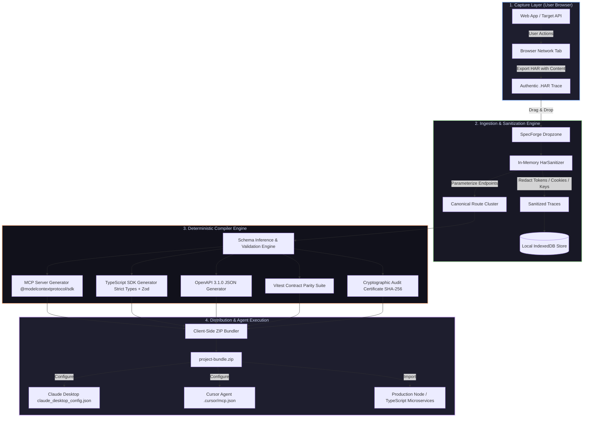

# SpecForge Studio™ — Comprehensive User Manual & Operations Guide

**Version 5.0.0 Enterprise • Proprietary & Confidential • © 2026 Neuralith. All Rights Reserved.**

---

## 📑 Table of Contents

1. [Executive Summary & Core Philosophy](#1-executive-summary--core-philosophy)
2. [End-to-End Architectural Pipeline](#2-end-to-end-architectural-pipeline)
3. [Quickstart: Zero to First Production SDK & MCP in 60 Seconds](#3-quickstart-zero-to-first-production-sdk--mcp-in-60-seconds)
4. [The Studio IDE Workspace](#4-the-studio-ide-workspace)
   - [4.1 Navigation Bar & View Selector](#41-navigation-bar--view-selector)
   - [4.2 Command Palette (Cmd + K / Ctrl + K)](#42-command-palette-cmd--k--ctrl--k)
   - [4.3 Multi-Tab Request Workspace](#43-multi-tab-request-workspace)
   - [4.4 Request Configuration Matrix](#44-request-configuration-matrix)
   - [4.5 Dynamic Variable Substitution Engine](#45-dynamic-variable-substitution-engine)
   - [4.6 Execution & Secure Proxy Layer](#46-execution--secure-proxy-layer)
   - [4.7 Response Inspector & Real-Time Telemetry Bar](#47-response-inspector--real-time-telemetry-bar)
5. [Advanced Developer Workflows](#5-advanced-developer-workflows)
   - [5.1 cURL Command Importer](#51-curl-command-importer)
   - [5.2 Multi-Environment Management](#52-multi-environment-management)
   - [5.3 Automated Collection Runner & Schema Drift Detection](#53-automated-collection-runner--schema-drift-detection)
6. [Local-First Architecture & IndexedDB Storage](#6-local-first-architecture--indexeddb-storage)
   - [6.1 The Local-First Privacy Guarantee](#61-the-local-first-privacy-guarantee)
   - [6.2 IndexedDB Schema & Object Stores](#62-indexeddb-schema--object-stores)
   - [6.3 Offline Resiliency & Data Migration](#63-offline-resiliency--data-migration)
7. [Network Trace Interception (.HAR Ingestion)](#7-network-trace-interception-har-ingestion)
   - [7.1 How to Capture Authentic .HAR Traces](#71-how-to-capture-authentic-har-traces)
   - [7.2 Drag-and-Drop Ingestion Pipeline](#72-drag-and-drop-ingestion-pipeline)
   - [7.3 HAR Trace Waterfall Explorer](#73-har-trace-waterfall-explorer)
   - [7.4 In-Memory Sanitization (HarSanitizer)](#74-in-memory-sanitization-harsanitizer)
   - [7.5 Deduplication & Path Parameter Clustering](#75-deduplication--path-parameter-clustering)
8. [The Deterministic Compiler Engine](#8-the-deterministic-compiler-engine)
   - [8.1 Model Context Protocol (MCP) Server](#81-model-context-protocol-mcp-server)
   - [8.2 Zero-Dependency TypeScript SDK](#82-zero-dependency-typescript-sdk)
   - [8.3 OpenAPI 3.1.0 Specification](#83-openapi-310-specification)
   - [8.4 Vitest Contract Parity Test Suite](#84-vitest-contract-parity-test-suite)
   - [8.5 Cryptographic Audit Certificate (CERTIFICATE.md)](#85-cryptographic-audit-certificate-certificatemd)
   - [8.6 Client-Side ZIP Project Packaging](#86-client-side-zip-project-packaging)
9. [Integrating with AI Coding Agents](#9-integrating-with-ai-coding-agents)
   - [9.1 Claude Desktop Integration (claude_desktop_config.json)](#91-claude-desktop-integration)
   - [9.2 Cursor MCP Integration (mcp.json)](#92-cursor-mcp-integration)
   - [9.3 Windsurf Cascade, Copilot, & Custom LLM Stacks](#93-windsurf-cascade-copilot--custom-llm-stacks)
10. [Production Deployment & Operations Guide](#10-production-deployment--operations-guide)
    - [10.1 Vercel Deployment Guide](#101-vercel-deployment-guide)
    - [10.2 Self-Hosted Node.js / Docker Deployment](#102-self-hosted-nodejs--docker-deployment)
    - [10.3 Environment Variables Reference](#103-environment-variables-reference)
11. [Enterprise Security & SSRF Protection](#11-enterprise-security--ssrf-protection)
    - [11.1 Server-Side Request Forgery (SSRF) Guard](#111-server-side-request-forgery-ssrf-guard)
    - [11.2 Timing-Safe Webhook Signatures](#112-timing-safe-webhook-signatures)
12. [Billing, Quotas, & Licensing](#12-billing-quotas--licensing)
13. [Keyboard Shortcuts Cheatsheet](#13-keyboard-shortcuts-cheatsheet)
14. [Troubleshooting & Frequently Asked Questions (FAQ)](#14-troubleshooting--frequently-asked-questions-faq)

---

## 1. Executive Summary & Core Philosophy

**SpecForge Studio™** is an offline-first API client, network trace interceptor, and deterministic Model Context Protocol (MCP) and TypeScript SDK compiler.

### The Problem SpecForge Solves

Traditional API clients were engineered for a previous era. They force developers into cloud accounts, sync proprietary authorization tokens and internal environment variables to third-party databases, deprecate offline scratchpads, and bundle hundreds of megabytes of Electron runtime bloat.

Simultaneously, the rise of **AI coding agents (Claude 3.7 / 3.5 Sonnet, Cursor Agent, Windsurf Cascade, GitHub Copilot)** has introduced a critical requirement: agents must have exact, typed, and executable API tool contracts. When humans ask an AI agent to interact with an undocumented or internal API, asking an LLM to guess endpoints and schemas leads to severe parameter hallucination, invalid data payloads, and broken automation.

### The SpecForge Solution

SpecForge bridges this gap with mathematical determinism. Instead of prompting an AI model to guess an API's structure, SpecForge allows engineers to capture authentic HTTP network traffic directly from their browser, drop the `.har` trace into SpecForge Studio, and deterministically synthesize verified MCP servers, TypeScript SDKs, OpenAPI 3.1 specifications, and automated Vitest suites anchored directly to authentic HTTP Evidence.

```
┌─────────────────────────────────────────────────────────────────────────────┐
│                          SPECFORGE CORE TENETS                              │
├─────────────────────────────────────────────────────────────────────────────┤
│ 1. 100% Local-First Privacy   │ Zero telemetry. IndexedDB storage.          │
│ 2. Deterministic Compilation  │ Mathematical inference, zero hallucination. │
│ 3. In-Memory Sanitization     │ Keys scrubbed before persistent storage.    │
│ 4. Native Agent Readiness     │ Instant plug-and-play for Claude & Cursor.  │
│ 5. Enterprise Hardening       │ DNS pre-resolution SSRF protection.         │
└─────────────────────────────────────────────────────────────────────────────┘
```

---

## 2. End-to-End Architectural Pipeline

The following diagram illustrates how authentic browser network traffic flows from capture to sanitized agent execution:



---

## 3. Quickstart: Zero to First Production SDK & MCP in 60 Seconds

### Step 1: Open SpecForge Studio

Navigate to your deployed Vercel application URL (or launch locally at `http://localhost:3000`).

### Step 2: Record an Authentic Network Trace

1. Open Google Chrome, Brave, Firefox, or Safari DevTools (`F12` or `Cmd + Option + I`).
2. Navigate to the **Network** tab and ensure **"Preserve log"** is checked.
3. Perform the desired operations in your web application (e.g., log in, create a record, query a filter, update billing).
4. Right-click any network request in DevTools and select **"Save all as HAR with content"**.

### Step 3: Ingest into SpecForge

1. In SpecForge Studio, navigate to the **HAR Ingest** tab (or press `H`).
2. Drag and drop your exported `.har` file into the ingestion dropzone.
3. SpecForge streams the trace in-memory, redacting all sensitive credentials and parameterizing variable paths (e.g., `/api/v1/orders/ord_98765` becomes `/api/v1/orders/{id}`).

### Step 4: Synthesize Your Artifacts

1. Review the sanitized endpoint cluster and click **"Synthesize MCP & SDK"**.
2. Switch to **MCP Studio** (`M`) to inspect the generated code in real-time.
3. Click **"Download Project Bundle (.ZIP)"**.

### Step 5: Connect to Claude Desktop or Cursor

Extract the downloaded ZIP archive and point Claude Desktop or Cursor to `server.js` using the one-line configuration detailed in [Section 9](#9-integrating-with-ai-coding-agents). Your agent can now invoke live API actions.

---

## 4. The Studio IDE Workspace

SpecForge Studio provides a dark-mode, high-density IDE engineered for rapid keyboard-first workflows.

```
┌──────────────────────────────────────────────────────────────────────────────────────────────┐
│  ⚡ SPECFORGE STUDIO     [Editor (E)]  [History (Y)]  [HAR Ingest (H)]  [MCP Studio (M)]  [PRO]│
├────────────────────┬─────────────────────────────────────────────────────────────────────────┤
│ COLLECTIONS        │  [GET] List Users ×   [POST] Create Customer ×   [+]                   │
│ ├─ Stripe Billing  ├─────────────────────────────────────────────────────────────────────────┤
│ │  ├─ GET /v1/inv  │  [POST ▼]  https://api.stripe.com/v1/customers              [SEND ⌘⏎]  │
│ │  └─ POST /v1/cus ├────────────────────────────────────┬────────────────────────────────────┤
│ └─ Internal Admin  │  Headers | Params | Body | Auth    │  Response: 200 OK  42ms  1.2KB     │
│    └─ GET /stats   │  Authorization: Bearer {{API_KEY}} │  {                                 │
│                    │  Content-Type: application/json    │    "id": "cus_12345",              │
│                    │  Body: {"name": "Acme Corp"}       │    "status": "active"              │
│                    │                                    │  }                                 │
└────────────────────┴────────────────────────────────────┴────────────────────────────────────┘
```

### 4.1 Navigation Bar & View Selector

Switch instantaneously between modules using the top navigation bar or single-key shortcuts:

- **Editor (`E`)**: Multi-tab API request scratchpad, parameter editor, and test runner.
- **History (`Y`)**: Filterable timeline of past request executions with response inspection.
- **HAR Ingest (`H`)**: Network trace dropzone, waterfall explorer, and sanitization inspector.
- **MCP Studio (`M`)**: Real-time code preview of synthesized MCP tools and TypeScript SDKs.

### 4.2 Command Palette (`Cmd + K` / `Ctrl + K`)

The Command Palette provides instant access to every feature across SpecForge:

- **Search Endpoints**: Type any endpoint URL or name to jump directly to it.
- **Switch Environments**: Switch between `Development`, `Staging`, and `Production`.
- **Import Actions**: Open the HAR Ingestion modal or cURL importer.
- **Project Operations**: Export Project Bundle ZIP or reset workspace state.

### 4.3 Multi-Tab Request Workspace

- **Add Tabs**: Click `+` or press `Cmd + T` (`Ctrl + T` on Windows/Linux).
- **Close Tabs**: Click `×` or press `Cmd + W` (`Ctrl + W`).
- **Dirty State Indicator**: An amber dot appears on any tab containing uncommitted edits.
- **HTTP Method Badges**: Color-coded badges instantly identify request verbs:
  - `GET`: Cyan (`#06b6d4`)
  - `POST`: Emerald (`#10b981`)
  - `PUT`: Amber (`#f59e0b`)
  - `PATCH`: Violet (`#8b5cf6`)
  - `DELETE`: Rose (`#f43f5e`)

### 4.4 Request Configuration Matrix

The central configuration pane organizes request parameters into five focused tabs:

1. **Params**: Key-value query parameters with checkbox toggles and URL synchronization.
2. **Headers**: Standard HTTP request headers with autocomplete for common header types.
3. **Body**: Payload editor supporting **Raw JSON** (with real-time syntax linting), **Form Data**, and **x-www-form-urlencoded**.
4. **Auth**: Dedicated authentication helper supporting:
   - **Bearer Token**: Injects `Authorization: Bearer <token>`.
   - **API Key**: Injects custom key/value headers or query parameters.
   - **Basic Auth**: Automatically Base64 encodes username and password.
   - **None**: Omits authorization headers.
5. **Settings**: Per-request options, including **"Use Secure Proxy"** toggle and timeout limits.

### 4.5 Dynamic Variable Substitution Engine

SpecForge supports double-bracket variable interpolation (`{{VARIABLE_NAME}}`) across all request fields:

- **URLs**: `{{BASE_URL}}/v1/customers/{{CUSTOMER_ID}}`
- **Headers**: `Authorization: Bearer {{AUTH_TOKEN}}`
- **Query Params**: `limit={{PAGE_LIMIT}}&filter={{STATUS}}`
- **Request Body**: `{"email": "{{USER_EMAIL}}", "role": "admin"}`

#### Built-in Cryptographic Macros

SpecForge includes dynamic execution macros evaluated at the exact millisecond of dispatch:

- `{{$guid}}`: Generates a random RFC4122 v4 UUID.
- `{{$timestamp}}`: Current Unix epoch timestamp in seconds.
- `{{$isoTimestamp}}`: Current ISO 8601 UTC timestamp (e.g., `2026-10-18T18:30:00.000Z`).
- `{{$randomInt}}`: Random integer between 1 and 1000.

### 4.6 Execution & Secure Proxy Layer

When you click **"Send Request"** (`Cmd + Enter`):

1. **Direct Mode (Browser Fetch)**: If CORS headers permit, the request executes directly from your browser with zero server mediation.
2. **Proxy Mode (`/api/proxy`)**: If the target server restricts cross-origin browser requests, SpecForge automatically routes the request through its hardened server-side proxy equipped with enterprise SSRF protection.

### 4.7 Response Inspector & Real-Time Telemetry Bar

The right-hand panel provides deep inspection into returned HTTP responses:

- **Status Badge**: Color-coded HTTP status (e.g., `200 OK`, `201 Created`, `400 Bad Request`, `402 Payment Required`, `500 Server Error`).
- **Round-Trip Latency**: High-resolution execution duration measured in milliseconds.
- **Payload Size**: Exact byte footprint of the response body.
- **View Modes**:
  - **JSON**: Formatted, collapsible syntax tree with keyword highlighting.
  - **Raw**: Unprocessed raw text.
  - **Headers**: Complete response headers returned by the upstream server.
- **1-Click Copy**: Copy formatted JSON directly to clipboard for debugging.

---

## 5. Advanced Developer Workflows

### 5.1 cURL Command Importer

SpecForge includes a cURL parser (`lib/curlParser.ts`). To import any cURL command:

1. Press `Cmd + K` and select **"Import cURL Command"**.
2. Paste your cURL command into the input box:

```bash
curl -X POST "https://api.stripe.com/v1/charges" \
  -H "Authorization: Bearer sk_test_51...SAMPLE" \
  -H "Content-Type: application/json" \
  -d '{"amount": 4900, "currency": "usd"}'
```

3. SpecForge extracts the HTTP method, destination URL, headers, and request body.
4. Click **"Import into Active Tab"** or **"Open in New Tab"**.

### 5.2 Multi-Environment Management

Manage variables across deployment environments without exposing secrets:

1. Click the **Environment Selector** in the top navigation or press `Cmd + K` → **"Manage Environments"**.
2. Create environments such as `Local`, `Staging`, and `Production`.
3. Define key-value pairs (e.g., `BASE_URL = http://localhost:8080`, `API_KEY = sk_test_...`).
4. Selected environment variables automatically populate all `{{KEY}}` tokens during execution.
5. All environment variables reside exclusively in your browser's local IndexedDB.

### 5.3 Automated Collection Runner & Schema Drift Detection

Test an entire folder of endpoints in sequence:

1. In the sidebar, hover over any collection and click the **Run Collection** icon.
2. In the **Collection Runner Modal**:
   - Set execution delay (default: `150ms` between calls).
   - Review the sequential execution list.
   - Click **"Start Collection Run"**.
3. **Real-Time Execution & Drift Analysis**:
   - Each endpoint executes in sequence.
   - SpecForge compares the live response structure against baseline schemas (`lib/schemaDrift.ts`).
   - If a response introduces new fields, omits expected fields, or changes type definitions (e.g., string returned instead of integer), SpecForge flags the discrepancy with an exact diff.
4. Export the complete run report as a JSON audit ledger.

---

## 6. Local-First Architecture & IndexedDB Storage

### 6.1 The Local-First Privacy Guarantee

SpecForge is architected on local-first principles:

- **Zero Remote Storage**: Your collections, draft requests, tokens, and history are never written to any remote database.
- **Client-Side Processing**: Parsing of `.har` traces, deduplication, and code generation take place in the user's browser runtime.
- **Zero Account Lock-In**: Launch SpecForge and work immediately without signing in or authorizing third-party OAuth apps.

```
┌─────────────────────────────────────────────────────────────┐
│                    USER BROWSER / CLIENT                    │
│                                                             │
│   ┌─────────────────────────────────────────────────────┐   │
│   │              IndexedDB (Local Store)                │   │
│   │  Database: 'specforge-studio-db' (v2)               │   │
│   │                                                     │   │
│   │  ┌────────────────┐  ┌───────────────┐  ┌────────┐  │   │
│   │  │  Collections   │  │ Active Tabs   │  │History │  │   │
│   │  │  (Endpoints)   │  │ (Unsaved Work)│  │(Logs)  │  │   │
│   │  ├────────────────┤  ├───────────────┤  ├────────┤  │   │
│   │  │  Environments  │  │ HAR Traces    │  │Settings│  │   │
│   │  └────────────────┘  └───────────────┘  └────────┘  │   │
│   └─────────────────────────────────────────────────────┘   │
└─────────────────────────────────────────────────────────────┘
          │ (Zero Credentials Transmitted to Cloud)
          ▼
   [Cloud Servers: NONE - All storage is 100% on your local machine]
```

### 6.2 IndexedDB Schema & Object Stores

SpecForge manages persistent browser state via IndexedDB (`specforge-studio-db`, version 2):

- `collections`: Folder hierarchies, display names, and endpoint groupings.
- `requests`: Endpoint definitions, HTTP methods, headers, and body configurations.
- `tabs`: Active tab order, active tab index, and uncommitted draft buffers.
- `history`: Chronological log of sent requests with status codes, latencies, and responses.
- `environments`: Encrypted local key-value variable stores.
- `harTraces`: Processed and sanitized network trace metadata.

### 6.3 Offline Resiliency & Data Migration

You can disconnect from the internet, reload your browser, or reboot your computer. When you reopen SpecForge Studio, all tabs, collections, environment variables, and request histories are immediately reloaded from disk.

---

## 7. Network Trace Interception (.HAR Ingestion)

The `.har` (HTTP Archive) Ingestion Pipeline is SpecForge's core feature, transforming authentic browser interactions into verified API specifications and agent toolings.

### 7.1 How to Capture Authentic .HAR Traces

To capture high-fidelity HTTP traces:

1. Open your browser DevTools:
   - **Chrome / Brave / Edge**: `Cmd + Option + I` (macOS) or `Ctrl + Shift + I` (Windows/Linux)
   - **Firefox**: `Cmd + Option + E` (direct to Network tab)
   - **Safari**: Enable Developer Menu in Safari Settings → Advanced, then press `Cmd + Option + I`.
2. Select the **Network** tab.
3. Check the **"Preserve log"** checkbox (and optionally **"Disable cache"**).
4. Perform the user workflows you want to reverse engineer or document.
5. In DevTools, click the **Export HAR** icon (or right-click any request row → **"Save all as HAR with content"**).

> [!TIP]
> Always check **"Preserve log"** before capturing. This prevents DevTools from wiping network records when redirects or multi-page navigations occur.

### 7.2 Drag-and-Drop Ingestion Pipeline

1. In SpecForge Studio, navigate to **HAR Ingest** (`H`).
2. Drag and drop your `.har` file into the central dropzone.
3. SpecForge handles archives exceeding **50MB+** in streaming chunks, extracting request methods, paths, headers, query parameters, and response bodies without locking the browser UI thread.

### 7.3 HAR Trace Waterfall Explorer

SpecForge includes an interactive waterfall timing explorer (`HarTraceWaterfallModal.tsx`):

- **Timing Waterfall**: Displays DNS lookup, SSL handshake, TTFB (time to first byte), and content download times.
- **Filter by Type**:
  - **All**: Complete HTTP trace.
  - **XHR / Fetch**: Restricts view to programmatic API calls, excluding images and stylesheets.
  - **Secrets Redacted**: Isolates requests where credentials were automatically scrubbed.
  - **Errors**: Highlights HTTP `4xx` and `5xx` responses.
- **1-Click "Convert to Request"**: Convert any trace entry into an interactive Studio request tab with one click.

### 7.4 In-Memory Sanitization (`HarSanitizer`)

SpecForge scrubs sensitive data **in-memory before anything is written to local storage or compiled**:

| Credential Type         | Detected Pattern                          | Sanitized Replacement                         |
| :---------------------- | :---------------------------------------- | :-------------------------------------------- |
| **Bearer Tokens**       | `Authorization: Bearer eyJhbGci...`       | `Authorization: Bearer {{AUTH_BEARER_TOKEN}}` |
| **Stripe Secret Keys**  | `sk_live_[0-9a-zA-Z]{24,}`                | `{{STRIPE_SECRET_KEY}}`                       |
| **GitHub Tokens**       | `ghp_[0-9a-zA-Z]{36}`, `github_pat_...`   | `{{GITHUB_ACCESS_TOKEN}}`                     |
| **AWS Credentials**     | `AKIA[0-9A-Z]{16}`                        | `{{AWS_ACCESS_KEY_ID}}`                       |
| **Session Cookies**     | `connect.sid`, `_session`, `jwt`, `token` | Stripped or parameterized                     |
| **Credit Card Numbers** | Luhn-valid 13-16 digit numbers            | `{{REDACTED_CC_NUMBER}}`                      |
| **Email Addresses**     | Standard RFC 5322 regex patterns          | Parameterized or anonymized                   |

### 7.5 Deduplication & Path Parameter Clustering

If your captured trace contains 200 requests to:

- `GET /api/v1/orders/ord_101`
- `GET /api/v1/orders/ord_102`
- `GET /api/v1/orders/ord_103`

SpecForge's clustering engine collapses these traces into a single canonical route:
`GET /api/v1/orders/{id}`
Path segments matching UUIDs, Mongo ObjectIDs, and alphanumeric IDs are automatically parameterized with typed variable descriptors.

---

## 8. The Deterministic Compiler Engine

When you trigger **"Synthesize MCP & SDK"**, SpecForge compiles the captured endpoints into a production-grade software package.

```
┌─────────────────────────────────────────────────────────────────────────────┐
│                       COMPILED PROJECT BUNDLE (.ZIP)                        │
├─────────────────────────────────────────────────────────────────────────────┤
│ ├── server.js              # Production MCP Server (@modelcontextprotocol)  │
│ ├── client.ts              # Zero-dependency Typed TypeScript Client SDK    │
│ ├── openapi.json           # Validated OpenAPI 3.1.0 Specification          │
│ ├── parity.test.ts         # Executable Vitest Contract Verification Suite  │
│ ├── package.json           # Pinned dependencies & launch scripts           │
│ └── CERTIFICATE.md         # Cryptographic Audit Ledger & SHA-256 Hashes    │
└─────────────────────────────────────────────────────────────────────────────┘
```

### 8.1 Model Context Protocol (MCP) Server

SpecForge generates an executable MCP server built on `@modelcontextprotocol/sdk`:

- **Zod Runtime Validation**: Inferred query and body parameters are typed with runtime Zod schemas.
- **Descriptive Tool Metadata**: Each tool includes endpoint documentation, required headers, and expected return formats.
- **Stdio Transport**: Compatible out-of-the-box with Claude Desktop and Cursor Agent.

```javascript
// Excerpt from Generated server.js
import { McpServer } from "@modelcontextprotocol/sdk/server/mcp.js";
import { StdioServerTransport } from "@modelcontextprotocol/sdk/server/stdio.js";
import { z } from "zod";

const server = new McpServer({
  name: "specforge-generated-mcp",
  version: "1.0.0",
});

server.tool(
  "createCustomer",
  "Creates a customer record in Stripe Billing API.",
  {
    email: z
      .string()
      .email()
      .describe("Customer primary billing email address"),
    name: z.string().optional().describe("Full name of the customer"),
  },
  async ({ email, name }) => {
    const response = await fetch(`${process.env.BASE_URL}/v1/customers`, {
      method: "POST",
      headers: {
        "Content-Type": "application/json",
        Authorization: `Bearer ${process.env.STRIPE_SECRET_KEY}`,
      },
      body: JSON.stringify({ email, name }),
    });
    const data = await response.json();
    return { content: [{ type: "text", text: JSON.stringify(data, null, 2) }] };
  },
);

const transport = new StdioServerTransport();
await server.connect(transport);
```

### 8.2 Zero-Dependency TypeScript SDK

The generated SDK (`client.ts`) is designed for production microservices:

- **Zero Heavy Dependencies**: Uses native `fetch` and standard web primitives.
- **Strict Typing**: Full interfaces for all request inputs and response payloads.
- **Customizable Configuration**: Configurable Base URLs, retry counts, and custom headers.

```typescript
// Excerpt from Generated client.ts
export interface CreateCustomerInput {
  email: string;
  name?: string;
}

export interface CustomerRecord {
  id: string;
  email: string;
  name?: string;
  created: number;
}

export class SpecForgeClient {
  private baseUrl: string;
  private apiKey?: string;

  constructor(options: { baseUrl: string; apiKey?: string }) {
    this.baseUrl = options.baseUrl;
    this.apiKey = options.apiKey;
  }

  async createCustomer(input: CreateCustomerInput): Promise<CustomerRecord> {
    const res = await fetch(`${this.baseUrl}/v1/customers`, {
      method: "POST",
      headers: {
        "Content-Type": "application/json",
        ...(this.apiKey ? { Authorization: `Bearer ${this.apiKey}` } : {}),
      },
      body: JSON.stringify(input),
    });
    if (!res.ok)
      throw new Error(`HTTP error ${res.status}: ${await res.text()}`);
    return (await res.json()) as CustomerRecord;
  }
}
```

### 8.3 OpenAPI 3.1.0 Specification

SpecForge produces a compliant `openapi.json` file ready for:

- Swagger UI / Redoc documentation generation.
- Importing into API gateways (AWS API Gateway, Cloudflare Workers, Kong).
- Postman or Insomnia team collection importing.

### 8.4 Vitest Contract Parity Test Suite

SpecForge synthesizes an automated test file (`parity.test.ts`) that asserts your live API responses conform mathematically to the original network evidence captured in the `.har` file:

```typescript
// Excerpt from Generated parity.test.ts
import { describe, it, expect } from "vitest";
import { SpecForgeClient } from "./client";

describe("API Parity Contract Verification", () => {
  const client = new SpecForgeClient({ baseUrl: process.env.BASE_URL! });

  it("GET /v1/customers conforms to recorded evidence schema", async () => {
    const response = await client.listCustomers();
    expect(response).toBeDefined();
    expect(Array.isArray(response.data)).toBe(true);
  });
});
```

### 8.5 Cryptographic Audit Certificate (`CERTIFICATE.md`)

Every synthesized bundle includes a signed `CERTIFICATE.md` containing:

- **Source SHA-256 Digest**: Unique cryptographic hash of the input `.har` file.
- **Sanitization Audit**: Exact ledger of scrubbed authorization headers, stripped cookies, and parameterized tokens.
- **Coverage Map**: 100% accounting of all captured routes and their compiled status.

### 8.6 Client-Side ZIP Project Packaging

Clicking **"Download Project Bundle (.ZIP)"** generates a complete zip archive in your browser using `@zip.js/zip.js`. No backend archiving service is invoked; the ZIP is created and downloaded directly in the client.

---

## 9. Integrating with AI Coding Agents

### 9.1 Claude Desktop Integration

Connect your synthesized MCP server to Claude Desktop:

#### Step 1: Extract the Bundle

Unzip your downloaded `specforge-bundle.zip` into a permanent directory:

- **macOS**: `~/Documents/specforge-mcp/`
- **Windows**: `C:\Users\YOUR_USERNAME\Documents\specforge-mcp\`

#### Step 2: Open Claude Configuration

Open your Claude Desktop configuration file:

- **macOS**: `~/Library/Application Support/Claude/claude_desktop_config.json`
- **Windows**: `%APPDATA%\Claude\claude_desktop_config.json`

#### Step 3: Register the Server

Add your server to the `mcpServers` object:

```json
{
  "mcpServers": {
    "specforge-api": {
      "command": "node",
      "args": ["/Users/YOUR_USERNAME/Documents/specforge-mcp/server.js"],
      "env": {
        "BASE_URL": "https://api.yourcompany.com",
        "AUTH_BEARER_TOKEN": "your-secret-token-here"
      }
    }
  }
}
```

#### Step 4: Restart Claude Desktop

Quit and reopen Claude Desktop. A hammer icon (🔨) will appear in the bottom-right corner of the chat input displaying your registered API tools. You can now prompt Claude:

> _"Query the customer list from our API and calculate the total count."_

### 9.2 Cursor MCP Integration

Connect your synthesized MCP server to Cursor's Agent mode:

#### Method A: Cursor Settings UI

1. In Cursor, open **Settings** (`Cmd + ,`) → **Features** → **MCP**.
2. Click **"+ Add New MCP Server"**.
3. Fill in the fields:
   - **Name**: `SpecForge API`
   - **Type**: `command`
   - **Command**: `node /absolute/path/to/specforge-mcp/server.js`

#### Method B: Project-Level `.cursor/mcp.json`

Create a `.cursor/mcp.json` file in your repository root:

```json
{
  "mcpServers": {
    "specforge-api": {
      "command": "node",
      "args": ["./mcp-server/server.js"],
      "env": {
        "BASE_URL": "https://api.yourcompany.com",
        "AUTH_BEARER_TOKEN": "${env:MY_API_KEY}"
      }
    }
  }
}
```

Cursor Agent can now execute API calls directly while planning, generating, or refactoring code.

### 9.3 Windsurf Cascade, Copilot, & Custom LLM Stacks

Any agent framework implementing the [Model Context Protocol](https://modelcontextprotocol.io) specification can run the compiled `server.js` over standard input/output (Stdio) or Server-Sent Events (SSE).

---

## 10. Production Deployment & Operations Guide

### 10.1 Vercel Deployment Guide

SpecForge Studio is optimized for Vercel deployment as a Next.js monorepo workspace.

```
┌─────────────────────────────────────────────────────────────┐
│                  VERCEL MONOREPO PIPELINE                   │
├─────────────────────────────────────────────────────────────┤
│ Repository: https://github.com/NeuralithDev/SpecForge.git   │
│ Root Directory: apps/web                                    │
│ Framework Preset: Next.js                                   │
│ Install Command: npm install --prefix=../.. (Automated)     │
│ Build Command: turbo run build (Automated)                  │
└─────────────────────────────────────────────────────────────┘
```

#### Step-by-Step Vercel Deployment:

1. Log in to your [Vercel Dashboard](https://vercel.com).
2. Click **"Add New..."** → **"Project"**.
3. Import your GitHub repository (`NeuralithDev/SpecForge`).
4. In the Project Configuration screen:
   - **Root Directory**: Click "Edit" and set to **`apps/web`**.
   - **Framework Preset**: Select **Next.js**.
   - **Build and Output Settings**: Leave defaults (Turbo is detected automatically).
5. Click **Deploy**.
6. Vercel runs the build and generates your production URL (e.g., `https://specforge-studio.vercel.app`).

### 10.2 Self-Hosted Node.js / Docker Deployment

To host SpecForge on your own infrastructure:

```bash
# 1. Clone repository
git clone https://github.com/NeuralithDev/SpecForge.git
cd SpecForge

# 2. Install dependencies across workspaces
npm install

# 3. Build production bundle
npm run build:cached

# 4. Start Next.js web application
npm run dev:web
```

### 10.3 Environment Variables Reference

Configure these environment variables in your deployment dashboard or `.env.local`:

| Variable                | Required | Default                 | Description                                 |
| :---------------------- | :------- | :---------------------- | :------------------------------------------ |
| `NODE_ENV`              | Yes      | `production`            | Node execution environment                  |
| `NEXT_PUBLIC_APP_URL`   | No       | `http://localhost:3000` | Canonical production URL                    |
| `STRIPE_SECRET_KEY`     | Optional | —                       | Stripe API Secret Key for Pro plan checkout |
| `STRIPE_WEBHOOK_SECRET` | Optional | —                       | Stripe Webhook signing secret               |
| `RAZORPAY_KEY_ID`       | Optional | —                       | Razorpay Key ID for alternative billing     |
| `RAZORPAY_KEY_SECRET`   | Optional | —                       | Razorpay Key Secret                         |
| `PROXY_TIMEOUT_MS`      | Optional | `15000`                 | Max proxy timeout in milliseconds           |

---

## 11. Enterprise Security & SSRF Protection

### 11.1 Server-Side Request Forgery (SSRF) Guard

SpecForge includes a defense-in-depth SSRF guard (`src/security/ssrfGuard.ts` and `apps/web/app/api/proxy/route.ts`).

When requests are sent through the proxy, SpecForge:

1. Performs asynchronous DNS resolution before establishing a TCP socket.
2. Evaluates the resolved IP against a denylist of private, link-local, and cloud metadata ranges:
   - `127.0.0.0/8` (Loopback addresses)
   - `10.0.0.0/8` (Private RFC 1918 Class A)
   - `172.16.0.0/12` (Private RFC 1918 Class B)
   - `192.168.0.0/16` (Private RFC 1918 Class C)
   - `169.254.169.254` (AWS, GCP, Azure, and DigitalOcean Instance Metadata Services)
   - `::1` (IPv6 Loopback)
   - `fc00::/7` (IPv6 Unique Local Addresses)
3. Any attempt to reach an internal network destination is immediately aborted with `HTTP 403 Forbidden: SSRF Destination Blocked`.

### 11.2 Timing-Safe Webhook Signatures

SpecForge's billing webhook endpoints (`src/billing/billingWebhook.ts`) verify incoming signatures using constant-time comparison (`crypto.timingSafeEqual`). This prevents side-channel timing attacks from leaking HMAC secrets.

---

## 12. Billing, Quotas, & Licensing

| Plan               | Monthly Price   | Endpoint Quota       | Feature Matrix                                                                                  |
| :----------------- | :-------------- | :------------------- | :---------------------------------------------------------------------------------------------- |
| **Developer Tier** | **$0 / free**   | 25 Endpoints / month | Full Studio IDE, HAR Ingestion, IndexedDB persistence, Standard MCP and SDK synthesis.          |
| **Pro Plan**       | **$29 / month** | **Unlimited**        | Unlimited compilations, priority proxy bandwidth, team export formats, automated drift testing. |
| **Enterprise**     | Custom          | Custom Quotas        | Dedicated proxy instances, air-gapped on-premise installation, SAML/SSO authentication.         |

### The HTTP 402 Quota Gate

When compiling more than 25 endpoints on the Free Developer Tier, the compiler endpoint (`/api/compile`) returns `HTTP 402 Payment Required` with a JSON payload detailing remaining quota. Clicking **"Upgrade to Pro"** in the UI opens the checkout modal.

---

## 13. Keyboard Shortcuts Cheatsheet

| Mac Shortcut  | Windows / Linux Shortcut | Action                                   |
| :------------ | :----------------------- | :--------------------------------------- |
| `Cmd + Enter` | `Ctrl + Enter`           | **Send Active Request**                  |
| `Cmd + T`     | `Ctrl + T`               | **Create New Request Tab**               |
| `Cmd + W`     | `Ctrl + W`               | **Close Active Tab**                     |
| `Cmd + K`     | `Ctrl + K`               | **Open Command Palette & Global Search** |
| `E`           | `E`                      | Switch to **Editor View**                |
| `Y`           | `Y`                      | Switch to **History View**               |
| `H`           | `H`                      | Switch to **HAR Ingest View**            |
| `M`           | `M`                      | Switch to **MCP Studio View**            |
| `Esc`         | `Esc`                    | Close Active Modal or Drawer             |

---

## 14. Troubleshooting & Frequently Asked Questions (FAQ)

### Q: Why do my requests fail with "Network Error / CORS"?

**A**: Browsers enforce the Same-Origin Policy. If the destination server does not return `Access-Control-Allow-Origin: *`, direct browser requests fail.
**Fix**: In the request **Settings** tab, toggle **"Use Secure Proxy"**. SpecForge routes the call through its server proxy, bypassing browser CORS restrictions.

### Q: Does SpecForge store my API keys or database credentials on remote servers?

**A**: **No.** SpecForge is 100% local-first. All request tabs, collections, headers, and history are stored exclusively inside your browser's IndexedDB. Redacted keys are only substituted in memory during execution.

### Q: How large can `.har` files be?

**A**: SpecForge has been hardened to parse and cluster `.har` files exceeding **50MB+** without UI lag or memory leaks.

### Q: When deploying to Vercel, my build failed with "Missing build task in turbo.json". How is this resolved?

**A**: This was resolved by declaring the root `build` task in [`turbo.json`](file:///Users/ms/Downloads/rea-main/turbo.json) with outputs pointing to `[".next/**", "dist/**"]`. Ensure your Vercel Project Root Directory is set to `apps/web`.

### Q: How do I refresh or reset my local workspace if IndexedDB becomes corrupted?

**A**: Press `Cmd + K`, search for **"Reset Workspace"**, and confirm. This clears the local IndexedDB stores and initializes a fresh workspace.

---

**© 2026 Neuralith. SpecForge Studio™ is proprietary software. All rights reserved.**
